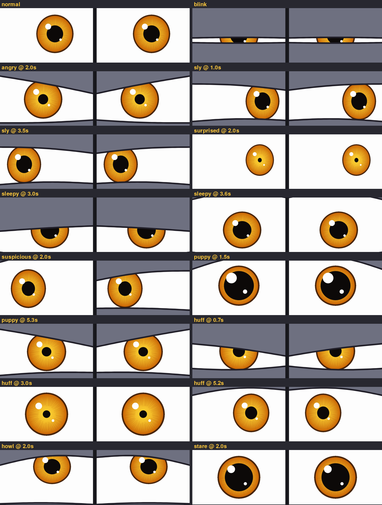

# Big Bad Wolf eyes (Canstruction 2026)

Two screens, one eye each. Each screen is the white of the eye; a cartoon amber
iris wanders around, blinks, and every 10–20 s the wolf goes into a mood with a
sound. Successor to last year's EVE eyes, but drawn live in code (no After
Effects videos), so it runs at any resolution.



| Key | Mood | What happens | Sound |
|---|---|---|---|
| 1 | angry | lids slam into a glare, tiny pupils, shaking | growl |
| 2 | sly | half-lidded side-eye, slow glide across | sniff + "I smell bacon" / "I'm so hungry" / "Come a little closer" |
| 3 | surprised | eyes pop wide, pinprick pupils, darting around | "Huh?! Who's there?" |
| 4 | sleepy | lids droop... jolt awake... droop | snoring |
| 5 | suspicious | one eye squints, other raised, shifty glances | sniff |
| 6 | puppy | huge innocent puppy eyes... then evil glare | "Little pig, let me come in!" + growl |
| 7 | huff | squeezes on "huff" and "puff", wide on "blow", then dizzy spinning eyes | "I'll huff and I'll puff..." |
| 8 | howl | looks up at the moon, eyes half closed | howl |
| 9 | stare | pupils grow huge | "All the better to see you with" / "I'm the big bad wolf" |

Other keys (plug in a keyboard): `0` back to normal, `b` blink, `s` random sound,
`m` mute, `q`/`Esc` quit. Moods also happen on their own, so no keyboard is needed.

## Setting up the Pi 5

1. **Plug in the screens**: left eye screen into **HDMI0** (the micro-HDMI port next to
   the USB-C power), right eye into **HDMI1**. Plug in the speaker (see *Sound* below).
   Connect the Pi to the internet.
2. Open a terminal on the Pi and paste this one line:
   ```bash
   cd ~ && (git -C canstruction pull || git clone https://github.com/RIT-iSchool/canstruction.git) && bash canstruction/2026_wolf_eyes/install_pi.sh
   ```
   It downloads the repo to `~/canstruction` (or updates it if it's already there),
   installs pygame, turns on desktop auto-login, switches off screen blanking, and adds
   the eyes to autostart. Run the same line again any time to pull the latest version.
3. `sudo reboot`. The eyes should come up by themselves with no cursor.

For the **first minute after power-on**, each screen shows "LEFT EYE" / "RIGHT EYE", a red
TOP marker and an arrow pointing to the MIDDLE (the other screen). If it's set up right, both
TOP markers point up and the two arrows point at each other. Wrong screens → `--swap` (see
Troubleshooting). Upside down → rotate that screen in the Pi's Screen Configuration. To change
how long they show, edit `LABEL_SECONDS`; to turn them off add `--no-labels` to `WOLF_ARGS`.

From then on: **power on → eyes start**. A Pi 5 boots as soon as it gets power.
If the eyes ever crash they restart within 5 s. If a screen is slow to wake up, the
launcher keeps retrying until both are there.

### Protect the SD card from the nightly power cut (recommended, do it last)
Pulling the power every night can eventually corrupt the SD card. Once everything
works, make the card read-only:
`sudo raspi-config` → *Performance Options* → *Overlay File System* → enable → reboot.
To change anything later (sounds, settings, or pulling an update with the line above),
turn the overlay **off** first, reboot, make the change, then turn it back on.

## Sound
The Pi 5 has **no headphone jack**. Use a USB speaker, a Bluetooth speaker, or
speakers in the HDMI screens. Pick the output by right-clicking the speaker icon on
the Pi's taskbar, and set the volume there. If audio isn't available at all, the eyes
still run, just silently.

Sounds live in `sounds/<type>/`. Any `.wav`, `.ogg` or `.mp3` you drop into a folder
gets used automatically:
- `growl/`, `howl/`, `sniff/`, `snore/`: animal sound effects
- `voice/`: the wolf's lines. Right now they're text-to-speech placeholders. To use
  your own recording, name it like the line it replaces (e.g. `little_pig_rec.wav`) and
  delete the TTS file. `huff_puff` is timed to the eye squeezes (huff ≈ 0.6 s,
  puff ≈ 1.7 s, blow ≈ 2.8 s), so a recording with similar timing looks best.

On the Mac, `bash tools/make_voices.sh Fred` rebuilds the TTS lines with another voice
(`say -v '?'` lists them; samples are in `voice_samples/`). `bash tools/prepare_sounds.sh`
rebuilds the effects from the original downloads in `sound_sources/`. Those originals
aren't in the git repo (Mixkit's license doesn't allow re-sharing the raw files), but
the links are in `CREDITS.md`.

## Testing on a laptop
```bash
pip install pygame
python3 wolf_eyes.py --mode preview
```
`--snapshot some_folder` saves a picture of every mood without opening a window.

## Tweaking
Settings at the top of `wolf_eyes.py`: time between moods, blink rate, how often
ambient sounds play, volume, colours, iris/pupil size. Moods are small functions
further down, and `MOOD_WEIGHTS` controls how often each one is picked.

## Troubleshooting
- **Eyes on the wrong screens** (angry brows slope the wrong way): in `run_wolf.sh` set
  `WOLF_ARGS="--mode dual --swap"`.
- **Both eyes on one screen, or one screen stays on the desktop**: try putting
  `export SDL_VIDEODRIVER=wayland` (or `x11`) near the top of `run_wolf.sh`. If that
  doesn't help, switch the Pi to X11 (`sudo raspi-config` → *Advanced Options* →
  *Wayland* → *X11*), arrange the screens side by side, and use
  `WOLF_ARGS="--mode span"`.
- **What happened?** Everything is logged to `logs/wolf.log`.
- **Stop it starting on boot**: `rm ~/.config/autostart/wolf-eyes.desktop`.

## Credits
See [CREDITS.md](CREDITS.md).
